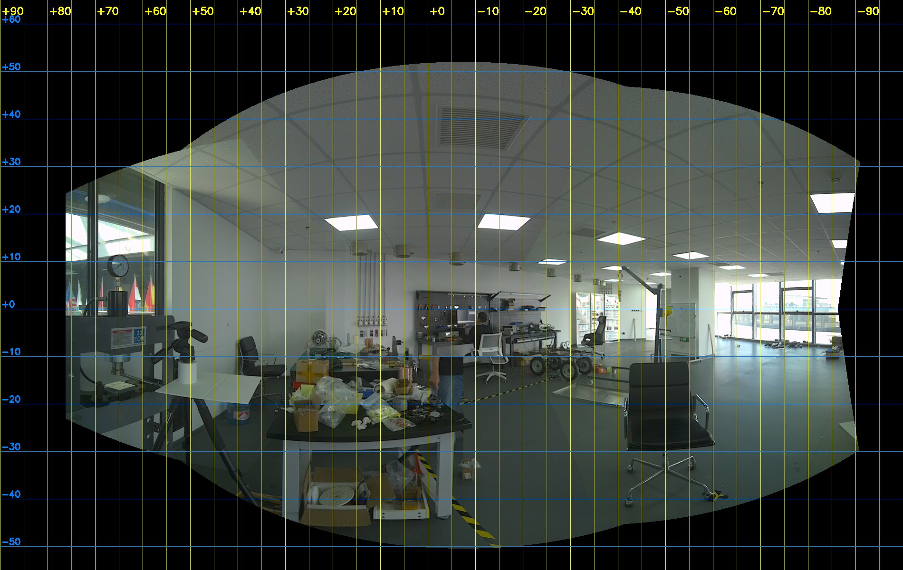

# FR5 + ZED X 高速数据录制（SIO_SLAM 机械臂真值，high-speed 分支）

> 本分支录制高速运动的数据。低速数据（0.05 m/s 平移、5 °/s 旋转，2026-10-12/13）及其真值验证见 main 分支或标签 `data-v1`。
> 脚本的正本在 Box 的 `~/ROBOT/fr5_record/`，本仓库是笔记本上的备份，用 `.\sync_from_box.ps1` 从 Box 拉取。
> 实验过程、工程细节和问题处理见 [实验记录.md](实验记录.md)。

## 1. 目标

用 FAIRINO FR5 机械臂带着 ZED X 做已知的高速运动，同时录制双目图像、ZED 机身 IMU 和机械臂状态，离线算出逐帧的相机位姿真值，供 [SIO_SLAM](https://github.com/lihongliang0203/SIO_SLAM) 评估快速运动下的表现。

计划 6 条录制（用户 10-14 定：每个方向只录一次，走满能走的范围，不回起点）：

| 运动 | 录制 | 内容 |
|---|---|---|
| 平移 0.5 m/s | `up`、`right`、`forward` | 相机水平，最下到最上、最左到最右、最后到最前 |
| 旋转 50 °/s | `yaw_left`、`pitch_up`、`roll_right` | 绕左目光心单轴转最大角度：偏航（右到左）、俯仰（下到上）、横滚（左到右） |

每条录制的范围由用户手动拖出的那一对极限位姿（拖动标记）来定，标记只是大概的极限，实际的路径由脚本按逆解、关节速度、右窗等往里收（3.4）。

- **相机**：30 fps，曝光 2.5 ms。
- **场景**：画面里不能有人走动，不能拍到右侧的落地窗（左窗可以拍）。
- **相机真值**：方法和低速数据相同，`base_T_camera(t) = base_T_flange(t) · flange_T_left_camera`。手眼外参来自标定仓库 [fr5-zedx-handeye-calibration](https://github.com/SaxonShang/fr5-zedx-handeye-calibration) s003 的结果（`scripts/handeye_s003_result.json`）。高速路径和新曝光下的修正量要用标定板重新验证（3.3）。
- 1 m/s 平移不可行：在现有关节范围内，前后方向连匀速段都放不下。

## 2. 硬件、网络与软件版本

| 项目 | 值 |
|---|---|
| 机械臂 | FAIRINO FR5，型号 `FR5-V1-002(V6.0)`；WebApp `v3.9.1`；控制器软件 `V3.9.5-QX`；**WebApp 自动模式速度百分比 60%** |
| 相机 | ZED X（S/N 49953548），ZED SDK 5.1.2，HD1080，**30 fps**，全局快门；**手动曝光 2.5 ms，模拟增益 13 dB**；录校正后的左右目 JPEG，关闭自标定 |
| 相机录制程序 | `zed_record`：帧率可设（`--fps 15/30/60`），3 个线程并行存 JPEG |
| 计算单元 | ZED Box Mini（Jetson，L4T R36.4.4，Ubuntu 22.04，Python 3.10），自带显示器和鼠标 |
| 网络 | Box 有线 `192.168.58.11/24` 用网线直连 FR5 控制器 `192.168.58.2`（固定 IP，无网关）；Box WiFi `10.255.250.132`（DHCP，可能会变），笔记本通过它 SSH：`ssh user@10.255.250.132` |
| 控制器端口 | 20003 XML-RPC 指令；20004 实时状态推送（同一时间只服务一个连接）；80 / 9999 WebApp |
| FAIRINO Python SDK | V2.2.1（对应机器人 V3.9.1）：官方仓库 `FAIR-INNOVATION/fairino-python-sdk` 提交 `060c68bb85f05d0097cc5efa360ddc61d6bb72e0` 的 `linux/fairino/Robot.py`，只依赖标准库 |
| 笔记本 | 标定板验证和图像检查用标定仓库 `D:\天府绛溪实验室\calibration` 的 `.venv`（OpenCV 4.14，带 aruco）；Box 上的 Python 导入不了 OpenCV |

## 3. 算法

### 3.1 相机真值

和低速数据相同：每张图像在曝光中心时刻插值法兰位姿（位置线性插值，姿态 SLERP），再乘手眼外参，得到左目相机在 FR5 基坐标系下的位姿；输出仍用图像原来的时间戳。

修正量按“路径组”记录（脚本参数 `PATH_SET`，本分支为 `fast2`，即按拖动标记定的路径；低速数据为 `base`），写进每条录制的 `motion_log.json`，真值脚本据此查表：

| 修正 | 低速数据（`base`） | 高速数据（`fast2`） |
|---|---|---|
| 时间：取真值的时刻再晚 | 4.27 ms（10 ms 曝光下测得） | **待测**：2.5 ms 曝光下曝光中心从 −3.4 ms 变为 +0.8 ms，这项要重新测 |
| 行程放大（平移） | 左右、上下 1.0070，前后 1.0015 | **待测**：新路径，暂不放大，真值报告里有警告 |
| 转角放大（旋转） | 俯仰向上 1.0043、向下 1.0052 | **待测**：转动中心和转角都按标记定，俯仰也不再是低速那条路径 |

同时输出一份不加这些修正的真值，用于对照。

### 3.2 时间同步

方法和低速数据相同：录制程序独占 20004 连接记下每个状态包的 Box 时间；控制器时钟按最小延迟的包直线拟合；剩余时间差 Δt 由 ZED 陀螺仪和法兰姿态的角速度大小互相关得到（每条录制开头和结尾各有一段同步摆动）；曝光中心由 `image_sync_trigger` 估计；`frame_lag_check.py` 检查图像内容和时间戳是否对齐。

### 3.3 真值验证（标定板）

方法和低速数据相同：标定板固定在相机前约 1.1 m，PnP 求出标定板位姿，乘真值后应始终不变；检查重复性、运动前后的差（行程 / 转角）和时间扫描。

**高速数据的验证待进行**：要测 2.5 ms 曝光下的时间修正、三条平移的行程系数和三种旋转的转角系数（都是新路径）。

### 3.4 运动与速度

- **拖动标记**：用户在手动模式下把机械臂拖到每个方向能接受的极限位姿，用 `mark` 记下来，共 12 个：平移 `down`/`up`、`left`/`right`、`backward`/`forward`，旋转 `yaw_right`/`yaw_left`、`pitch_down`/`pitch_up`、`roll_left`/`roll_right`。每对标记定一条录制，标记只是大概的极限，不当端点，拖的时候相机不必很正。标记的构型（肘部、腕部朝哪边）必须和常用构型（参考起点，关节约 [119.5, 14.4, −74.3, −120.0, −44.8, 0.0]）相同，不同时 `mark` 拒绝记录：录制用直线运动，到不了另一种构型。
- **由一对标记定路径**（`fr5_limits.py`，不连机械臂）：
  - **平移**：相机水平、姿态全程不变。前后、左右的方向取两个标记光心连线的水平分量，光轴（前后）或相机 x 轴（左右）沿这个方向；路径水平地经过两个标记，高度取两者平均。上下沿竖直方向，水平位置取两个标记的中点，相机朝向取两个标记的平均。
  - **旋转**：绕两个标记光心的中点转（MoveC）。偏航绕竖直轴、相机水平；俯仰绕水平相机的 x 轴，横滚绕水平相机的光轴，朝向取两个标记的平均。转角范围就是两个标记在这个角上的读数，不要求对称。
  - 两个标记偏离路径较多时（平移：高差或水平距离超过 30 mm，姿态差超过 5°；旋转：两个光心相距超过 50 mm，另外两个角超过 5°）会提醒，路径照上面的规则取。
- **收两端**（`fit_path`，用控制器逆解，不动机械臂）：两端先各收进 `LIMIT_MARGIN_MM` = 30 mm（平移；行程端点还要做同步摆动，法兰会横着摆出约 25 mm）或 `LIMIT_MARGIN_DEG` = 3°（旋转），再每 10 mm / 1° 采样逆解，取能走的最长一段，并往里收到：
  - 关节在允许范围内（`JOINT_MIN/MAX_DEG`，再用这对标记的关节角外扩 2° 放宽）、和常用构型相同、相邻采样点之间不跳支；
  - 光心不低于 0.35 m，画面离右窗至少 1°；
  - 平移两端能做同步摆动；
  - 按录制速度（满速，`--scale` 降速演练时路径不变）走时关节不超过 150 °/s：有 `speed-test` 的加速度时按梯形速度曲线算（两端在加减速），没有时按全程匀速（偏保守，收得多）。

  `plan` 打印每条录制最后的范围，以及两端各自停在那里的原因（标记、关节范围、关节速度、右窗、同步摆动……）。行程至少 0.15 m、转角至少 15°，不够就不录。
- **不回起点**：每条录制开头从机械臂当前位姿直接直线移到这条录制的起点（50 mm/s，不录制），逆解检查走不通时（例如在另一种构型、或者离得太远中途关节超范围）先手动拖到这条录制的起点附近。`set-start` 的起点只当参考位姿：定右窗的方向、常用构型，sync-test、movec-test 在那里做。
- **录哪个方向**：平移 `up`（最下到最上）、`right`（最左到最右）、`forward`（最后到最前），旋转 `yaw_left`（右到左）、`pitch_up`（下到上）、`roll_right`（左到右）；反方向（`down`、`left`、`backward`、`yaw_right`、`pitch_down`、`roll_left`）走同一条路径，也能录。
- 10-14 上午按“经过起点的轴 + 固定行程”离线算的路径（前后 440、左右 530、上下 440 mm，偏航 30°、俯仰 30°、横滚 90°，路径组 `fast1`）已不用。
- **同步摆动**：平移录制只往左摆 10°（画面右边缘离右窗更远）；旋转录制绕本条的转轴往内侧摆；都是 20 °/s、来回 2 次。
- **不拍右窗**：玻璃区域（`GLASS_REGIONS`）只有右窗，从参考起点的光心看、相对它的朝向给出；收两端时和 `plan`、`record` 都检查画面边缘离它至少 1°。光心不在参考起点时按窗户离参考起点至少 7 m 算视差（偏保守）。

  

  *全景图：横轴方位角、纵轴仰角（°），以起点光心为球心、相对起点水平朝向，向左为正。左侧 +57° 以左是左窗，右侧 −60° 以右是落地窗。*

- **关节速度**：录制前按预计速度检查每段路径上的关节速度，超过 150 °/s（FR5 额定 180 °/s）就拒绝；有实测加速度时按梯形速度曲线算（行程两端在加减速）。
- **运动模糊**：曝光 2.5 ms 时，0.5 m/s 平移在 1 m 处 0.92 px，50 °/s 旋转在画面中心 1.6 px。
- **图像**：2.5 ms、13 dB 的亮度和低速数据（10 ms、1 dB）相近，时间噪声约为它的 2 倍（2.1 对 1.05 个灰度级）。30 fps 下 60 s 空录不丢帧（帧间隔 31–35 ms）。
- **保护**：和低速数据相同（超速、光心偏离、状态中断、停顿时 StopMotion；Ctrl+C、SSH 断开时先停机械臂再停相机）。0.5 m/s 时停车距离约 0.1 m。

## 4. 脚本与参数

### 4.1 文件

| 文件 | 说明 |
|---|---|
| `scripts/run_session.py` | 总控脚本，**所有可改参数都在文件开头**。子命令：`set-start`、`mark <方向>`、`limits`、`plan`、`goto-start`、`speed-test`、`sync-test`、`movec-test`、`record <方向>`；选项 `--scale`、`--yes`、`--tag` |
| `scripts/fr5_motion.py` | 运动规划与执行：直线平移、绕光心的单轴旋转、同步摆动，逆解、关节速度和玻璃窗检查，速度换算，运动中的保护 |
| `scripts/fr5_limits.py` | 拖动标记 → 录制路径：由一对标记定方向、姿态和转动中心，用控制器逆解收两端（3.4） |
| `scripts/fr5_record.py` | 机械臂状态录制：独占 20004，每包记 Box 时间，停止时一次写盘 |
| `scripts/zed_capture.py` | zed_record 子进程管理（启动、正常停止、检查是否正常退出） |
| `scripts/fr5_groundtruth.py` | 离线真值：时钟拟合 → Δt → 曝光中心 → 修正（按路径组查表）→ 插值出相机真值（只依赖 numpy） |
| `scripts/gt_board_check.py` | 标定板真值验证（笔记本上运行） |
| `scripts/frame_lag_check.py` | 检查图像内容和时间戳是否错位（笔记本上运行），有异常时退出码为 1 |
| `scripts/camera_s003_refit.yaml` | ZED 校正后左目 HD1080 内参，用 s003 图像重标 |
| `scripts/test_*.py` | 离线测试（合成数据、假逆解，不连机械臂），共 86 项；要 OpenCV 的只在笔记本上运行，要 FAIRINO SDK 的只在 Box 上运行，缺了自动跳过 |
| `scripts/movel_probe.py` | 诊断：发零行程的 MoveL / MoveJ，看控制器拒绝哪种参数 |
| `scripts/handeye_s003_result.json` | 标定仓库 `results/s003/result.json` 的副本（手眼外参） |
| `scripts/start_pose.json` | `set-start` 保存的水平参考起点：相机光心约 (597, −476, 562) mm；右窗的方向、常用构型以它为准，录制不回这里 |
| `scripts/limit_poses.json` | `mark` 记下的拖动标记（法兰位姿、关节角，Box 上生成） |
| `scripts/speed_calibration.json` | `speed-test` 的结果（速度换算系数和加速度） |
| `zed_record/zed_record.cpp`、`zed_record.patch` | Box 上 `~/ROBOT/zed_imu/zed_record.cpp` 的当前版本，以及相对原版的改动（可设曝光、增益和帧率，多线程存图，第 30 帧读回实际曝光和增益） |
| `docs/` | README 用的图片 |
| `sync_from_box.ps1` | 从 Box 拉取 `scripts/` 和 `zed_record/` |
| `data/` | 从 Box 拷到笔记本的录制数据（不进 git） |

### 4.2 可调参数（`run_session.py` 开头）

超出范围脚本会拒绝运行。速度和曝光的组合还必须满足“最近物体处的模糊 ≤ `MAX_BLUR_PX`”。

| 参数 | 默认 | 范围 | 说明 |
|---|---|---|---|
| `PATH_SET` | fast2 | 字母、数字、`_`、`-` | 这一套路径几何的名字，写进 `motion_log.json`，真值按它查修正量；重新拖动标记、路径变了就换个名字 |
| `SPEED_MPS` | 0.5 | 0.02–0.6 | 平移速度 m/s |
| `TRANSLATION_WIGGLE_SIDE` | 1 | −1 / 0 / 1 | 平移录制和 sync-test 的同步摆动：1 只往左，0 两边，−1 只往右 |
| `ROT_DEG_S` | 50 | 1–60 | 旋转角速度 °/s |
| `GLASS_REGIONS` | 右窗 | | 画面里不能出现的玻璃：每块是（方位角起、止、仰角下、上），从参考起点的光心看、相对它的水平朝向 |
| `GLASS_MARGIN_DEG` | 1.0 | 0.5–5 | 画面离玻璃的最小角距离 |
| `WINDOW_DISTANCE_M` | 7 | 3–50 | 玻璃离参考起点光心的最近距离，光心不在参考起点时按它算视差 |
| `CAMERA_FPS` | 30 | 15 / 30 / 60 | 相机帧率，传给 zed_record |
| `EXPOSURE_US` | 2500 | 1000–15000 | 曝光，传给 zed_record |
| `ANALOG_GAIN_MDB` | 13000 | 1000–16000 | 模拟增益，传给 zed_record |
| `MAX_BLUR_PX` / `NEAREST_DEPTH_M` | 2.0 / 1.0 | 0.3–2.0 / 0.3–20 | 允许的运动模糊（1080p 像素），以及画面里最近物体的距离 |
| `HOLD_START_S` / `HOLD_MID_S` / `HOLD_END_S` | 5 / 3 / 5 | 3–30 / 2–30 / 3–30 | 开头、中间、结尾的静止时长 |
| `WIGGLE_DEG` / `WIGGLE_DEG_S` / `WIGGLE_CYCLES` | 10 / 20 / 2 | 5–15 / 12–40 / 1–4 | 同步摆动的幅度、角速度和来回次数 |
| `SYNC_TEST_HOLD_S` | 10 | 5–60 | sync-test 两次摆动之间的静止时长 |
| `REPOSITION_MPS` | 0.05 | 0.01–0.10 | 录制前从当前位姿移到录制起点的速度 |
| `WEBAPP_SPEED_PCT` | 60 | 1–100 | WebApp 里的速度百分比，照抄过来（SDK 读不到）；改了要重跑 speed-test |
| `ACCEL_PCT` | 100 | 1–100 | MoveL 加速度百分比；改了要重跑 speed-test |
| `SPEED_TEST_PCT` | 5 | 1–10 | speed-test 去程的速度百分比（speed-test 走上下那条路径的全程） |
| `MAX_SPEED_ERROR` / `MAX_SPEED_RIPPLE` | 0.10 / 0.05 | 0.02–0.3 / 0.01–0.2 | 平移实测速度偏差、匀速段波动超过它就警告 |
| `MIN_CAMERA_Z_M` | 0.35 | 0–1.5 | 相机光心最低高度（基坐标系 z） |
| `LIMIT_MARGIN_MM` / `LIMIT_MARGIN_DEG` | 30 / 3 | 10–100 / 1–10 | 平移行程两端、旋转范围两端先离拖动标记收进这么多 |
| `MIN_STROKE_M` / `MAX_STROKE_M` | 0.15 / 1.0 | 0.05–0.5 / 0.2–1.2 | 平移行程收完后的下限（不够就不录）和上限 |
| `MIN_ROTATION_DEG` / `MAX_ROTATION_DEG` | 15 / 180 | 5–60 / 20–180 | 旋转转角的下限（不小于 `WIGGLE_DEG`）和上限 |
| `JOINT_MIN_DEG` / `JOINT_MAX_DEG` | 见文件 | | 允许的关节范围：J2 ≤ 34°，J4、J5 限制在已安全走过的范围，J6 为起点 ±50°；每条录制再用它那一对拖动标记的关节角（外扩 2°）放宽 |
| `MAX_JOINT_STEP_DEG` | 5 | 1–15 | 路径上每 10 mm / 2° 允许的最大关节变化，超过说明逆解可能跳支 |
| `MAX_JOINT_SPEED_DEG_S` | 150 | 30–170 | 录制段关节速度上限 °/s |
| `MIN_FREE_GB` | 5 | 1–100 | 开始录制前 Box 至少剩余的磁盘空间 |

`fr5_groundtruth.py` 开头的修正表：`TIME_CORRECTION_MS`、`TRAVEL_SCALE`、`ROTATION_SCALE`（后两个按路径组分开，3.1）。命令行选项 `--time-correction-ms`、`--scale-factor`、`--rotation-scale-factor` 可以手动指定。

## 5. 使用流程

### 5.1 安装（Box）

1. **SDK**：把第 2 节那个提交的 `linux/fairino/Robot.py` 放到 `~/.local/lib/python3.10/site-packages/fairino/`，再建一个空的 `__init__.py`，用 `sha256sum` 核对（`b0dbb2e4…103e`）。
2. **zed_record**：源码在 `~/ROBOT/zed_imu/`，打上 `zed_record/zed_record.patch` 后编译：
   ```bash
   cd ~/ROBOT/zed_imu/build && make -j4 zed_record
   ```
3. **脚本**：把 `scripts/` 里的文件放到 Box 的 `~/ROBOT/fr5_record/`。
4. **WebApp**：在 Box 上用 Falkon 打开（`falkon http://192.168.58.2/ &`），自动模式速度百分比设为 60%，和 `WEBAPP_SPEED_PCT` 一致。

### 5.2 录制步骤

在 Box 自己的终端里运行，人站在机械臂旁边，手边有急停。每次运动前脚本都会列出计划，输入 `yes` 才会动。

0. **拖动标记**：切到手动模式，把机械臂拖到某个方向能接受的极限，松手停稳后记下；12 个逐个做，顺序随意，不用先回起点：
   ```bash
   cd ~/ROBOT/fr5_record
   python3 run_session.py mark down          # 平移：down / up、left / right、backward / forward
   python3 run_session.py mark yaw_right     # 旋转：yaw_right / yaw_left、pitch_down / pitch_up、roll_left / roll_right
   python3 run_session.py limits             # 列出全部标记和每条录制的路径（不连机械臂）
   ```
   拖的时候保持常用构型（5.4），相机大致水平；旋转尽量绕相机转，平移尽量只沿一个方向走，偏得多时 `mark` 会提醒。一对记完后 `mark` 就会列出这一条的路径。记完切回自动模式。
1. **速度标定**：改了 WebApp 速度百分比后必须先跑。在上下那条路径上走全程，先低速，再全速：
   ```bash
   python3 run_session.py speed-test --scale 0.2
   python3 run_session.py speed-test
   ```
   结果里有加速度和上下那条的匀速段长度。
2. **空跑检查**：`python3 run_session.py plan`（不动），按标记定 6 条录制的路径、用逆解收两端，检查关节范围、关节速度和右窗；每条打印最后的范围和两端停在那里的原因。speed-test 之后要再跑一次（有了加速度，两端收得少）。
3. **分档演练**：每条录制先降速跑（路径和正式录制相同），旁边有人盯着腕部、线缆和周围障碍物：
   ```bash
   python3 run_session.py record up --scale 0.2
   python3 run_session.py record up --scale 0.5
   ```
   演练的数据不用。开头从当前位姿直接移到录制起点；这一段检查不过时，先手动拖到这条录制的起点附近再试。
4. **时间同步和标定板验证**：`sync-test`（在参考起点，先 `goto-start`），以及 5.3 的标定板录制。
5. **正式录制**，共 6 条：
   ```bash
   python3 run_session.py record up              # 平移：up（最下到最上）、right（最左到最右）、forward（最后到最前）
   python3 run_session.py record yaw_left        # 旋转：yaw_left（偏航，右到左）、pitch_up（俯仰，下到上）、roll_right（横滚，左到右）
   ```
6. **录完的检查**（拷到笔记本后，在 `scripts/` 下用标定仓库的 venv 运行）：
   ```bash
   python -B frame_lag_check.py <save_data 目录> ...
   ```
   报“晚约 1 帧”的重录；还要确认画面里没有人走动、没有右窗。

- **每条录制的结构**：（从当前位姿移到录制起点，不录）→ 静止 5 s → 同步摆动 → 静止 3 s → 平移或旋转 → 静止 3 s → 同步摆动 → 静止 5 s，约 25 s；30 fps 时每条约 0.6 GB。结束后自动计算真值。
- **录制失败**：zed_record 没有正常结束时，最后打印“录制失败”，退出码为 1，这条要重录。
- `--tag board`：给录制目录名加后缀，用来区分验证录制和正式录制。

### 5.3 标定板真值验证

1. 标定板竖直放在相机正前方约 1.1 m 处（对着这条录制的中间位姿），中心大致和相机同高，固定牢；短暂打开 ZED Explorer 确认它在画面中间附近，然后关掉。
2. 6 条正式录制各录一条验证录制（路径和正式录制相同）：
   ```bash
   python3 run_session.py record up --tag board
   python3 run_session.py record right --tag board
   python3 run_session.py record forward --tag board
   python3 run_session.py record yaw_left --tag board
   python3 run_session.py record pitch_up --tag board
   python3 run_session.py record roll_right --tag board
   ```
3. 拷到笔记本的 `data/board_check/<录制名>/`（`save_data/right/` 不用拷），在 `scripts/` 下运行：
   ```bash
   python -B frame_lag_check.py ..\data\board_check\<录制名>\save_data
   python -B gt_board_check.py ..\data\board_check\<录制名>\save_data
   ```

### 5.4 注意事项

- **高速运动的安全**：WebApp 60% 时所有运动都比低速数据快；0.5 m/s 时停车距离约 0.1 m。第一次走新路径时盯住肘部和机柜边缘。标记就是用户认可的极限：拖的时候就要确认那个位姿周围没有障碍物（录制两端离标记至少 30 mm / 3°）。
- **拖动时保持常用构型**：录制用直线运动，到不了肘部或腕部翻到另一边的位姿；拖动时关节大致保持参考起点的样子（关节 [119.5, 14.4, −74.3, −120.0, −44.8, 0.0]，J3、J5 为负），`mark` 发现构型不同会拒绝记录。
- **20004 只能有一个连接**：录制时不要另开 `Robot.RPC(...)`，运动脚本必须用 `StateRecorder.open_rpc()`。
- **录制进程里不要做长时间的 Python 计算**；**不要调用 SDK 的 `LoggerInit()`**（会持续写日志）。
- **相机同一时间只能被一个程序打开**：录制前关掉 ZED Explorer、Depth Viewer 等。
- **Box 的 WiFi 会断**：运动和录制在 Box 本机终端运行。拷大量数据时先在 Box 上打 tar 包，再限速拷（如 `scp -l 24000`），拷完核对 sha256。
- **开机预热**：Box 重启后预热 30 分钟以上再录真值数据。
- **错误码**：SDK 返回的正数错误码来自控制器，查 FAIRINO 官方“错误码对照表”。

## 6. 输出数据

每条录制一个目录（Box 上）：

```text
~/ROBOT/sessions/YYYYmmdd_HHMMSS_<名称>[_<tag>]/
├─ zed_record.log            zed_record 的输出（结束时一次写入）
├─ run_session.log           仅在 SSH 断开 / 被终止时才有
└─ save_data/
   ├─ left/  right/          <ZED 时间戳 ms>.jpg（校正后，JPEG）
   ├─ img_timeline.csv       每帧：图像时间戳、对应 IMU 时间戳、文件名（按时间顺序）
   ├─ zed_imu.csv            机身 IMU 全部样本（约 200 Hz），含 image_sync_trigger
   ├─ time_meta.txt          相机设置（帧率、曝光、增益），含第 30 帧读回的实际曝光和增益
   ├─ fr5_state.csv          机械臂状态（约 100 Hz）：Box 时间、控制器时间、关节、法兰位姿、错误码等
   ├─ fr5_meta.json          丢包、断线、时钟跳变等
   ├─ motion_log.json        参数（含 PATH_SET）、拖动标记和由它定的路径（mark_path：两个标记、路径、收两端的结果和原因）、
   │                         每段指令和实测速度、预计关节速度；旋转录制还有转轴、转动中心和光心偏离；录制失败时 error 写明原因
   ├─ groundtruth_tum.txt    每张图一行：timestamp tx ty tz qx qy qz qw（Unix 秒、米），左目在 FR5 基坐标系下（已加修正）
   ├─ groundtruth_tum_uncorrected.txt  同上，不加修正（对照用）
   ├─ groundtruth_arm_rate_tum.txt   机械臂每个状态包一行，格式同上（已加修正）
   ├─ groundtruth_images.csv         每张图的真值和标记（ok / duplicate / outside / gap / robot_error）
   └─ groundtruth_report.json        时钟拟合、Δt、前后段差、曝光中心、各项修正（含路径组）、警告
```

笔记本上的副本放在 `data/` 下（不进 git）：高速正式录制计划放在 `data/recordings_fast/`，标定板验证录制在 `data/board_check/<录制名>/`。

真值可以单独重算：

```bash
python3 fr5_groundtruth.py <save_data 目录> --handeye handeye_s003_result.json
```

两个检查脚本在 `save_data` 目录里输出：`gt_board_check.py` 写 `board_check_report.json` 和 `board_check_frames.csv`；`frame_lag_check.py` 写 `frame_lag_report.json`。
